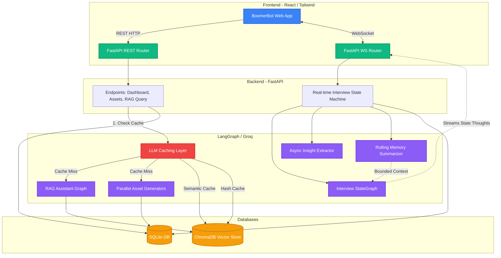

# BoomerBot Enterprise Architecture

BoomerBot is a scalable, AI-powered enterprise knowledge preservation system. The architecture is split between a React frontend and a FastAPI backend, heavily utilizing LangGraph for complex agentic workflows and ChromaDB for both Vector Retrieval and LLM Prompt Caching.

## System Architecture Diagram

## Key Components

### 1. The Frontend (React + Framer Motion)
The client application handles robust state management and fluid UI animations. Key features include the `Capture.tsx` live-streaming websocket interface that visualizes agent thoughts in real-time, and the `Assistant.tsx` citation split-pane which strictly highlights RAG source documents.

### 2. Live Voice Agent (LangGraph + WebSockets)
Located in `ws.py` and `voice_graph.py`, this is a bidirectional streaming agent. Rather than a simple LLM call, it uses a StateGraph to route user input dynamically (e.g. mapping workflows vs troubleshooting errors). It utilizes **Rolling Memory Summarization** to mathematically bound its context window, ensuring it never hits an API rate limit regardless of interview length.

### 3. Asynchronous Asset Generation
Located in `rest.py`, the asset generator transforms unstructured interview transcripts into structured Markdown (`SOP`, `FAQ`, `Troubleshooting Guide`). It utilizes `asyncio.gather` to trigger 3 separate AI Agents in parallel, aggressively bypassing Token-Per-Minute restrictions.

### 4. RAG Knowledge Assistant (LangGraph)
Located in `langgraph_agent.py`, the assistant allows users to query preserved knowledge. It features a grading node to detect hallucinations and prevent irrelevant answers.

### 5. Multi-Tier Caching System (ChromaDB)
To optimize LLM costs and latency without relying on external infrastructure like Redis, ChromaDB was re-purposed as a robust Edge Cache:
- **Semantic Cache:** Detects if a user's question semantically matches a previous question (Distance < 0.20) and instantly returns the cached JSON.
- **Hash Cache:** MD5-hashes the raw interview transcript before Asset Generation, bypassing the AI entirely if an expert regenerates assets without modifying the source text.
