# BoomerBot — Architecture Reference

> Engineering deep-dive for the BoomerBot enterprise knowledge-preservation platform.
> For the short pitch-level summary, see [architecture.md](../architecture.md) at the repository root.

---

## Table of Contents

1. [Overview](#1-overview)
2. [Technology Stack](#2-technology-stack)
3. [System Container Diagram](#3-system-container-diagram)
4. [Repository Layout](#4-repository-layout)
5. [Backend Deep-Dive](#5-backend-deep-dive)
6. [Data Model](#6-data-model)
7. [Authentication and RBAC](#7-authentication-and-rbac)
8. [REST API Reference](#8-rest-api-reference)
9. [Real-Time Interview Subsystem](#9-real-time-interview-subsystem)
10. [Voice Interview LangGraph](#10-voice-interview-langgraph)
11. [Asset Generation and Multi-Tier Caching](#11-asset-generation-and-multi-tier-caching)
12. [RAG Knowledge Assistant](#12-rag-knowledge-assistant)
13. [Data Quality Scanner](#13-data-quality-scanner)
14. [Frontend Architecture](#14-frontend-architecture)
15. [End-to-End Knowledge Lifecycle](#15-end-to-end-knowledge-lifecycle)
16. [Local Development Setup](#16-local-development-setup)
17. [Known Limitations and Hardening Backlog](#17-known-limitations-and-hardening-backlog)

---

## 1. Overview

### Problem

When a senior domain expert leaves an organisation, the *tacit* knowledge they hold — the
undocumented workarounds, the "we always check this before running that" heuristics, the edge
cases nobody wrote down — leaves with them. Traditional knowledge management fails here because
it asks busy experts to write documentation, which they never do.

### Approach

BoomerBot inverts the model: instead of asking experts to *write*, it **interviews** them. An
AI agent conducts a voice-driven conversation, adapts its questioning strategy in real time,
extracts structured insights as the expert talks, and afterwards converts the raw transcript into
publishable knowledge assets (SOPs, FAQs, troubleshooting guides). Those assets are embedded into
a vector store so the rest of the organisation can query them through a RAG assistant.

### Core capabilities

| Capability | Where it lives |
| --- | --- |
| Resume ingestion and expert onboarding | `POST /api/sessions/upload-resume` |
| Adaptive voice interview over WebSocket | [backend/app/api/ws.py](../backend/app/api/ws.py) + [voice_graph.py](../backend/app/services/voice_graph.py) |
| Live insight and knowledge-gap extraction | [ai_service.py](../backend/app/services/ai_service.py) |
| Parallel asset generation with hash caching | `POST /api/sessions/{id}/generate-assets` |
| Retrieval-augmented Q&A with grading | [langgraph_agent.py](../backend/app/rag/langgraph_agent.py) |
| Cross-sheet data quality auditing | [anomaly_detector.py](../backend/app/services/anomaly_detector.py) |
| Knowledge network visualisation | `GET /api/network-graph` |

### Architectural principles

- **Agentic, not single-shot.** Both the interviewer and the assistant are LangGraph state
  machines with explicit routing and self-critique nodes, not one-off prompt calls.
- **Bounded context by construction.** Interview memory is compressed by a rolling summariser so
  token usage stays flat regardless of interview length.
- **Zero external cache infrastructure.** ChromaDB is repurposed as both a vector store and a
  two-tier LLM cache, avoiding a Redis dependency.
- **Streaming-first.** The interview streams tokens *and* agent state transitions to the browser
  so the UI can visualise what the agent is thinking.

---

## 2. Technology Stack

### Backend

| Concern | Library | Version |
| --- | --- | --- |
| Web framework | `fastapi` | 0.141.1 |
| ASGI server | `uvicorn` | 0.53.0 |
| WebSockets | `websockets` | 16.1.1 |
| ORM | `sqlalchemy` | 2.0.52 |
| Validation / settings | `pydantic`, `pydantic-settings` | 2.13.5 / 2.15.0 |
| Password hashing | `bcrypt` | 5.0.0 |
| JWT | `python-jose` | 3.5.0 |
| Corporate TLS trust | `truststore` | 0.10.4 |

### AI and data

| Concern | Library | Version |
| --- | --- | --- |
| LLM client | `openai` (OpenAI-compatible, pointed at VW LLMaaS) | 3.13.0 |
| Fallback LLM client | `groq` | 0.37.1 |
| Agent orchestration | `langgraph` | 1.2.11 |
| LLM abstractions | `langchain-core`, `langchain-openai`, `langchain-groq` | 1.6.3 / 1.6.2 / 1.1.3 |
| Vector database | `chromadb` (local, persistent) | 1.5.9 |
| Embeddings | VW LLMaaS `text-embedding-3-large` (3072d) | — |
| LLM model | `gpt-4o` via VW Cloud LLMaaS | — |
| Tabular / Excel | `pandas`, `openpyxl` | 3.0.5 / 3.1.5 |
| PDF extraction | `pypdf` | 6.18.1 |

### Frontend

| Concern | Library | Version |
| --- | --- | --- |
| UI framework | `react` | 19.2.8 |
| Language | `typescript` | 6.0.2 |
| Build tool | `vite` | 8.3.0 |
| Routing | `react-router-dom` | 7.18.3 |
| Animation | `framer-motion` | 13.2.0 |
| Styling | `tailwindcss` + `cva` + `tailwind-merge` + `clsx` | 3.4.19 |
| Icons | `lucide-react` | 1.44.0 |
| Graph visualisation | `react-force-graph-2d` | 1.29.1 |
| Linting | `oxlint` | 1.81.0 |
| Speech I/O | Browser Web Speech API | native |

---

## 3. System Container Diagram

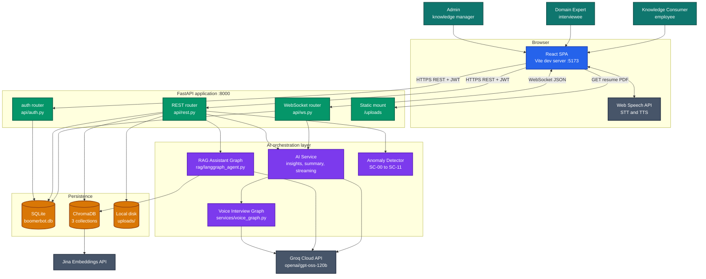

---

## 4. Repository Layout

```text
Hackathon/
├── architecture.md              # short pitch-level overview
├── docs/
│   └── architecture.md          # this document
├── backend/
│   ├── requirements.txt
│   ├── .env                     # secrets, not committed
│   ├── boomerbot.db             # SQLite database
│   ├── chroma_db/               # ChromaDB persistent store
│   ├── uploads/                 # uploaded resumes, served at /uploads
│   ├── myvenv/                  # virtualenv (excluded from tooling)
│   ├── migrate_db.py            # idempotent ALTER TABLE migrations
│   ├── seed_from_excel.py       # bootstrap DB + vector store from dataset
│   ├── test_anomaly.py          # smoke test for the scanner
│   └── app/
│       ├── main.py              # startup, CORS, router wiring, admin seed
│       ├── api/
│       │   ├── auth.py          # login, profile, user invitations
│       │   ├── rest.py          # dashboard, experts, sessions, assets, assistant
│       │   └── ws.py            # /ws/session/{id} interview socket
│       ├── core/
│       │   ├── config.py        # pydantic-settings, reads .env
│       │   └── security.py      # bcrypt, JWT, get_current_user, require_role
│       ├── database/session.py  # engine, SessionLocal, get_db dependency
│       ├── models/              # SQLAlchemy ORM models
│       │   ├── base.py
│       │   ├── user.py
│       │   └── session.py       # Expert, KnowledgeSession, Transcript, Insight, Asset
│       ├── schemas/session.py   # Pydantic request/response models
│       ├── rag/
│       │   ├── chroma.py        # collections, indexing, semantic + asset caches
│       │   └── langgraph_agent.py  # retrieve -> grade -> generate graph
│       └── services/
│           ├── ai_service.py        # streaming, insight extraction, summarisation
│           ├── voice_graph.py       # adaptive interview state machine
│           └── anomaly_detector.py  # SC-00..SC-11 cross-sheet audit
└── frontend/
    ├── vite.config.ts
    ├── tailwind.config.js
    └── src/
        ├── main.tsx             # provider composition
        ├── App.tsx              # route table
        ├── contexts/            # AuthContext, ThemeContext
        ├── hooks/useSpeech.ts   # SpeechRecognition + SpeechSynthesis
        ├── lib/utils.ts         # cn() class merger
        ├── components/
        │   ├── layout/          # Shell, Sidebar, TopNav, ProtectedRoute
        │   └── capture/         # ExpertProfile, ChatInterface, AudioVisualizer, LiveExtraction
        └── pages/               # 11 route-level pages
```

---

## 5. Backend Deep-Dive

### Startup sequence

[backend/app/main.py](../backend/app/main.py) executes the following in strict order:

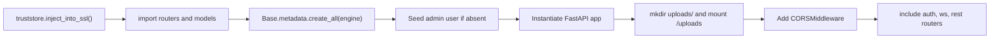

1. **TLS trust injection.** `truststore.inject_into_ssl()` runs *before every other import*. It
   swaps Python's `ssl.SSLContext` for one backed by the operating-system certificate store, so
   outbound HTTPS calls to Groq and Jina succeed on corporate networks that perform TLS
   inspection (e.g. Zscaler). It must run first because
   [ai_service.py](../backend/app/services/ai_service.py) constructs its Groq HTTP clients at
   *import* time. On machines without TLS interception this is a harmless no-op.
2. **Schema creation.** `Base.metadata.create_all(bind=engine)` creates any missing tables. Note
   this does not alter existing tables — see [migrate_db.py](../backend/migrate_db.py).
3. **Admin seeding.** If no user with email `admin@boomerbot.com` exists, one is created with a
   bcrypt hash of `password123` and role `ADMIN`. This exists for demo bootstrapping.
4. **Static mount.** `uploads/` is created if missing and served at `/uploads`, which is how the
   frontend links to uploaded resume PDFs.
5. **CORS.** Currently fully permissive (`allow_origins=["*"]`) — see
   [§17](#17-known-limitations-and-hardening-backlog).
6. **Routers** are included in order: `auth`, `ws`, `rest`. A `GET /` health endpoint returns a
   welcome payload.

### Configuration

[backend/app/core/config.py](../backend/app/core/config.py) defines a `pydantic_settings.BaseSettings`
subclass that reads from `.env`:

| Setting | Default | Purpose |
| --- | --- | --- |
| `PROJECT_NAME` | `"BoomerBot API"` | OpenAPI title |
| `SECRET_KEY` | hardcoded demo value | JWT signing key |
| `ALGORITHM` | `"HS256"` | JWT algorithm |
| `ACCESS_TOKEN_EXPIRE_MINUTES` | `60 * 24 * 7` (7 days) | Token lifetime |
| `LLM_PROVIDER` | `"llmaas"` | `llmaas` (VW Cloud) or `groq` fallback |
| `LLMAAS_CLIENT_ID` / `LLMAAS_CLIENT_SECRET` | `""` | OAuth client-credentials grant against VW Cloud IDP |
| `LLMAAS_API_KEY` | `""` | Sent as the `X-LLM-API-CLIENT-ID` header |
| `LLMAAS_CHAT_MODEL` | `"gpt-4o"` | Chat/completions model |
| `LLMAAS_EMBEDDING_MODEL` | `"text-embedding-3-large"` | 3072-dimension embeddings |
| `EMBEDDING_PROVIDER` | `"local"` | `llmaas` / `jina` / `local`; changing it requires re-indexing |
| `SEMANTIC_CACHE_THRESHOLD` | `0.45` | Max distance treated as a cache hit |
| `GROQ_API_KEY` | `""` | Fallback provider |
| `JINA_API_KEY` | `""` | Alternative embedder |
| `CLOUDINARY_URL` | `""` | Optional asset storage |
| `DATABASE_URL` | `"sqlite:///./boomerbot.db"` | SQLAlchemy connection string |

### LLMaaS access

[backend/app/core/llmaas.py](../backend/app/core/llmaas.py) owns provider access. VW Cloud IDP issues
**30-minute** bearer tokens via a `client_credentials` grant, so the token is cached and refreshed
120 seconds before expiry; the OpenAI clients are rebuilt whenever it rotates. This matters because
the app runs far longer than one token lifetime — a statically-constructed client would start
returning 401 on every call roughly half an hour after startup.

`get_langchain_chat()` returns `ChatOpenAI` bound to LLMaaS, or `ChatGroq` when `LLM_PROVIDER=groq`,
so every LangGraph node switches providers from a single environment variable.

### Database session management

[backend/app/database/session.py](../backend/app/database/session.py) builds the engine with
`check_same_thread=False` when the URL is SQLite (required because FastAPI serves requests from a
thread pool), exposes a `SessionLocal` factory, and provides a `get_db()` generator dependency
that yields a session and closes it in a `finally` block.

### Layering

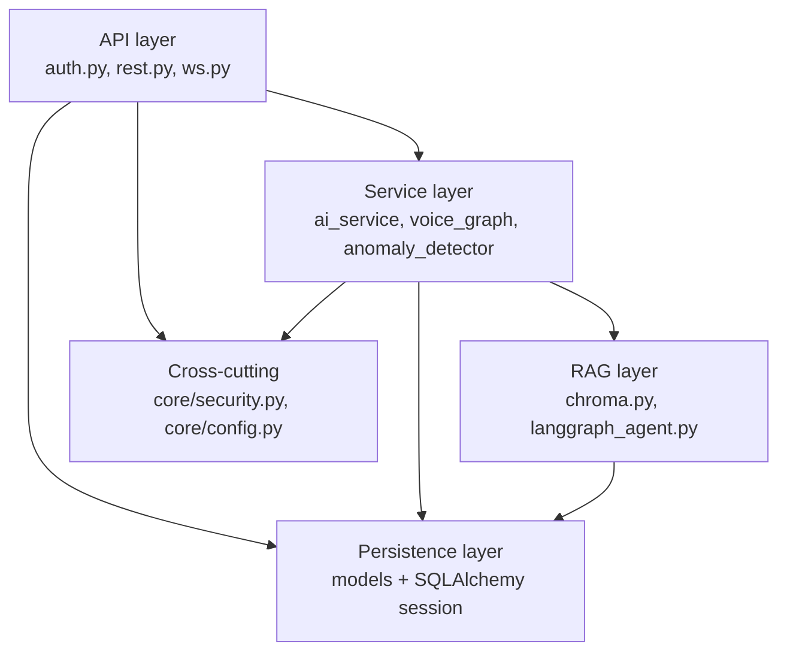

---

## 6. Data Model

All primary keys are string UUIDs generated application-side; all tables carry a UTC `created_at`
timestamp.

### Entity relationship diagram

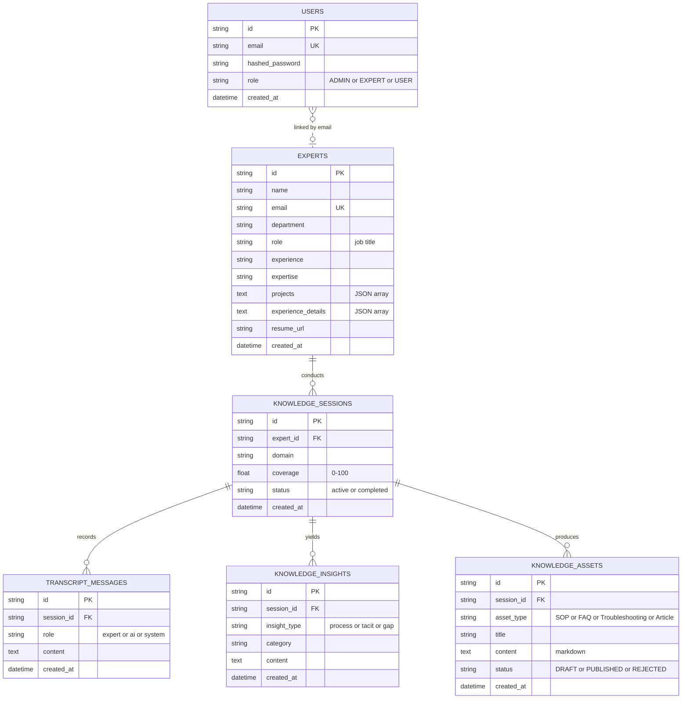

### Relationship notes

- `Expert.sessions` is a one-to-many relationship with **cascade delete**, so removing an expert
  removes their sessions and, transitively, their messages, insights, and assets.
- `KnowledgeSession.messages` and `.insights` also cascade.
- `User` and `Expert` are **not** joined by a foreign key. They are correlated by email address;
  `DELETE /api/experts/{expert_id}` deletes the matching `User` row explicitly.
- `TranscriptMessage.role == "system"` is a special marker: its content is prefixed with
  `SUMMARY:` and it stores the rolling conversation summary (see [§9](#rolling-memory-compression)).

### Pydantic schemas

[backend/app/schemas/session.py](../backend/app/schemas/session.py) mirrors the ORM layer:

| Schema | Shape |
| --- | --- |
| `TranscriptMessageBase` | `role`, `content` |
| `TranscriptMessageCreate` | inherits base |
| `TranscriptMessageOut` | base + `id`, `created_at` |
| `KnowledgeInsightBase` | `insight_type`, `category`, `content` |
| `KnowledgeInsightOut` | base + `id`, `created_at` |
| `KnowledgeSessionBase` | `expert_name`, `domain` |
| `KnowledgeSessionCreate` | inherits base |
| `KnowledgeSessionOut` | base + `id`, `coverage`, `status`, `created_at`, `messages[]`, `insights[]` |

### Migrations

There is no Alembic setup. [backend/migrate_db.py](../backend/migrate_db.py) is a hand-rolled
idempotent script that issues `ALTER TABLE knowledge_sessions ADD COLUMN ...` for `department`,
`role`, `experience`, and `expertise`, swallowing the error if the column already exists.

---

## 7. Authentication and RBAC

### Mechanism

- **Password hashing** — `bcrypt.gensalt()` + `bcrypt.hashpw()`; `verify_password` uses
  `bcrypt.checkpw()` and returns `False` on any exception.
- **Token issuance** — `create_access_token(subject)` builds `{"sub": str(user_id), "exp": ...}`
  and signs it with HS256 using `settings.SECRET_KEY`. Default lifetime is 7 days.
- **Token validation** — `get_current_user` decodes the bearer token, reads `sub`, loads the
  `User` row, and raises `401` if decoding fails or the user is gone.
- **Authorisation** — `require_role(["ADMIN"])` returns a dependency that depends on
  `get_current_user` and raises `403` if `current_user.role` is not in the allow-list.

All of the above lives in [backend/app/core/security.py](../backend/app/core/security.py).

### Login sequence

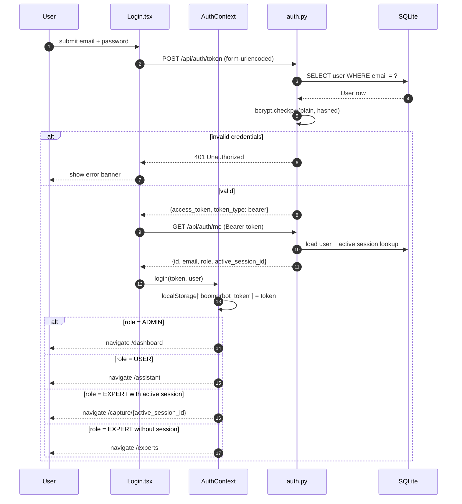

On page reload, `AuthContext` rehydrates from `localStorage` and re-validates by calling
`GET /api/auth/me`; a failure clears the stored token.

### Role permission matrix

| Area | ADMIN | EXPERT | USER |
| --- | :---: | :---: | :---: |
| Dashboard stats / at-risk | ✅ | ❌ | ❌ |
| Expert directory and detail | ✅ | ❌ | ❌ |
| Delete expert | ✅ | ❌ | ❌ |
| Upload resume / onboard expert | ✅ | ❌ | ❌ |
| Invite / list / delete users | ✅ | ❌ | ❌ |
| Dataset anomaly scan | ✅ | ❌ | ❌ |
| Session list | ✅ | ❌ | ❌ |
| Session detail / complete / generate assets | ✅ | ✅ | ❌ |
| Interview WebSocket | ✅ | ✅ | ❌ |
| List / view assets | ✅ | ✅ | ✅ |
| Publish / reject asset | ✅ | ❌ | ❌ |
| RAG assistant query | ✅ | ❌ | ✅ |
| Network graph | ⚠️ unauthenticated | ⚠️ | ⚠️ |

---

## 8. REST API Reference

Base URL in development: `http://localhost:8000`. All routes except where noted require an
`Authorization: Bearer <jwt>` header.

### Authentication — [backend/app/api/auth.py](../backend/app/api/auth.py)

| Method | Path | Auth | Description |
| --- | --- | --- | --- |
| `POST` | `/api/auth/token` | public | OAuth2 password grant. Form fields `username`, `password`. Returns `{access_token, token_type}`. |
| `GET` | `/api/auth/me` | any authenticated | Returns `{id, email, role, active_session_id}`. `active_session_id` drives the EXPERT redirect. |
| `POST` | `/api/users/invite` | ADMIN | Body `{email}`. Generates a random password, creates the user, returns the plaintext credentials once. |
| `GET` | `/api/users/invited` | ADMIN | Lists invited users as `[{id, email, created_at}]`. |
| `DELETE` | `/api/users/{user_id}` | ADMIN | Revokes access. Returns `{status: "deleted"}`. |

### Dashboard — [backend/app/api/rest.py](../backend/app/api/rest.py)

| Method | Path | Auth | Description |
| --- | --- | --- | --- |
| `GET` | `/api/dashboard/stats` | ADMIN | Aggregate counts (`total_assets`, `total_sessions`, `total_insights`, `total_experts`, `domains`, `avg_coverage`) plus a `recent_sessions` array with per-session message and insight counts. |
| `GET` | `/api/dashboard/at-risk` | ADMIN | Experts whose knowledge capture is incomplete: `[{id, name, department, risk_reason, coverage}]`. |

### Experts

| Method | Path | Auth | Description |
| --- | --- | --- | --- |
| `GET` | `/api/experts` | ADMIN | Directory listing with `session_count` per expert. |
| `GET` | `/api/experts/{expert_id}` | ADMIN | Full profile including parsed `projects`, `resume_url`, nested `sessions[]` and `assets[]`. |
| `DELETE` | `/api/experts/{expert_id}` | ADMIN | Cascades to sessions/messages/insights/assets and deletes the linked `User`. |
| `POST` | `/api/sessions/upload-resume` | ADMIN | Multipart upload of a PDF plus optional `expert_email` form field. See flow below. |

**Resume onboarding flow** (`upload-resume`): the PDF is saved to `uploads/`, text is extracted
with `pypdf`, the synchronous Groq client parses it into structured fields (name, department, job
title, years of experience, expertise, projects), an `Expert` row is created, a `User` row with
role `EXPERT` and a generated password is created, and an initial `KnowledgeSession` is opened.
The response returns the one-time credentials for the admin to hand to the expert.

### Sessions

| Method | Path | Auth | Description |
| --- | --- | --- | --- |
| `GET` | `/api/sessions` | ADMIN | All sessions with expert name, domain, coverage, status. |
| `GET` | `/api/sessions/{session_id}` | ADMIN, EXPERT | Session detail: full message history, insights, coverage, status. Used by the Capture page on load. |
| `POST` | `/api/sessions/{session_id}/complete` | ADMIN, EXPERT | Marks `status = "completed"`. |
| `POST` | `/api/sessions/{session_id}/generate-assets` | ADMIN, EXPERT | Transcript → SOP + FAQ + Troubleshooting guide. See [§11](#11-asset-generation-and-multi-tier-caching). |

### Knowledge assets

| Method | Path | Auth | Description |
| --- | --- | --- | --- |
| `GET` | `/api/assets` | ADMIN, USER, EXPERT | All assets with type, status, owning expert and domain. |
| `GET` | `/api/assets/{asset_id}` | ADMIN, USER, EXPERT | Full markdown body of one asset. |
| `POST` | `/api/assets/{asset_id}/publish` | ADMIN | Sets `status = "PUBLISHED"` and indexes the content into the `boomerbot_knowledge` Chroma collection. |
| `POST` | `/api/assets/{asset_id}/reject` | ADMIN | Sets `status = "REJECTED"`; the asset is never indexed. |

### Assistant, graph, and admin tooling

| Method | Path | Auth | Description |
| --- | --- | --- | --- |
| `POST` | `/api/assistant/query` | ADMIN, USER | Body `{question}`. Semantic-cache lookup, then the RAG graph. Returns answer, sources, and exact quotes. |
| `GET` | `/api/network-graph` | ⚠️ **none** | Force-graph payload `{nodes: [{id, name, group}], links: [{source, target, value}]}`. Groups: 1 = department, 2 = expert, 3 = session/domain, 4 = insight. |
| `POST` | `/api/admin/scan-dataset` | ADMIN | Multipart `.xlsx` upload. Returns the SC-00..SC-11 anomaly report. |
| `GET` | `/` | public | Health check. |

---

## 9. Real-Time Interview Subsystem

The interview runs over a single WebSocket at **`/ws/session/{session_id}`**, implemented in
[backend/app/api/ws.py](../backend/app/api/ws.py).

### Message protocol

**Client → server**

| `type` | Payload | Effect |
| --- | --- | --- |
| `start_session` | — | Generates and streams a personalised greeting, then persists it as an `ai` message. |
| `expert_message` | `{content: string}` | Full turn: persist, summarise if needed, stream a response, extract insights, update coverage. |

**Server → client**

| `type` | Payload | Meaning |
| --- | --- | --- |
| `ai_state_change` | `{state: string}` | The agent moved to a new LangGraph node, e.g. "Routing to troubleshooting mode...". Drives the thinking indicator. |
| `ai_stream` | `{token: string}` | One word of the response, emitted with a ~50 ms delay for natural TTS pacing. |
| `ai_stream_end` | — | Response complete; the client finalises the bubble and speaks it. |
| `ai_insights` | `{insights[], gaps[], coverage, is_complete}` | Extraction finished; updates the live extraction panel and the coverage meter. |

### Turn sequence

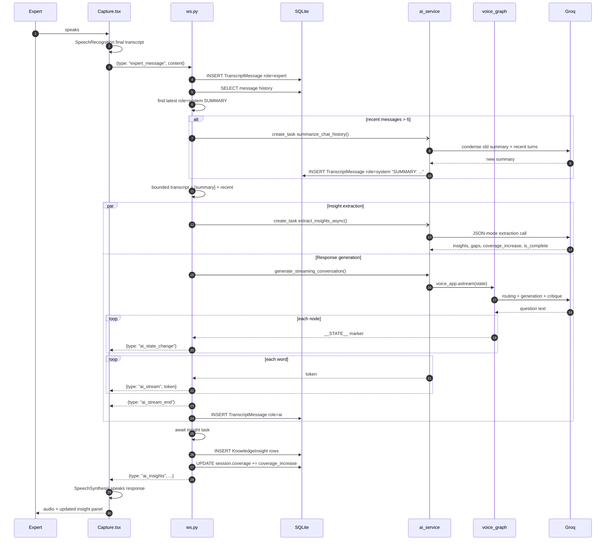

### Rolling memory compression

Interview transcripts grow without bound, which would eventually exceed the model's context
window and the provider's tokens-per-minute quota. BoomerBot solves this with a rolling summary:

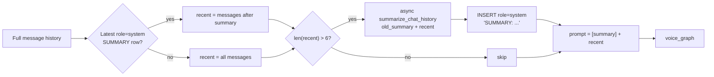

The effect is that prompt size is **bounded by a constant** rather than growing linearly with
interview length. Summarisation runs as a fire-and-forget `asyncio` task so it never blocks the
expert's turn.

### Session bootstrapping

If a WebSocket connects for a `session_id` that does not exist, the handler auto-provisions a demo
expert (*Rajesh Kulkarni*, Senior SAP Consultant, Enterprise Operations, 18 years, SAP SD) and a
session in the domain *SAP Order Management*. This keeps the hackathon demo path frictionless; it
would be removed in production.

---

## 10. Voice Interview LangGraph

Defined in [backend/app/services/voice_graph.py](../backend/app/services/voice_graph.py).

### State

```python
class VoiceGraphState(TypedDict):
    expert_name: str
    domain: str
    projects: list
    experience_details: list
    transcript_text: str      # bounded transcript
    current_stage: str        # mapping | troubleshooting | wrap_up
    generation: str           # the question to ask next
```

### Graph

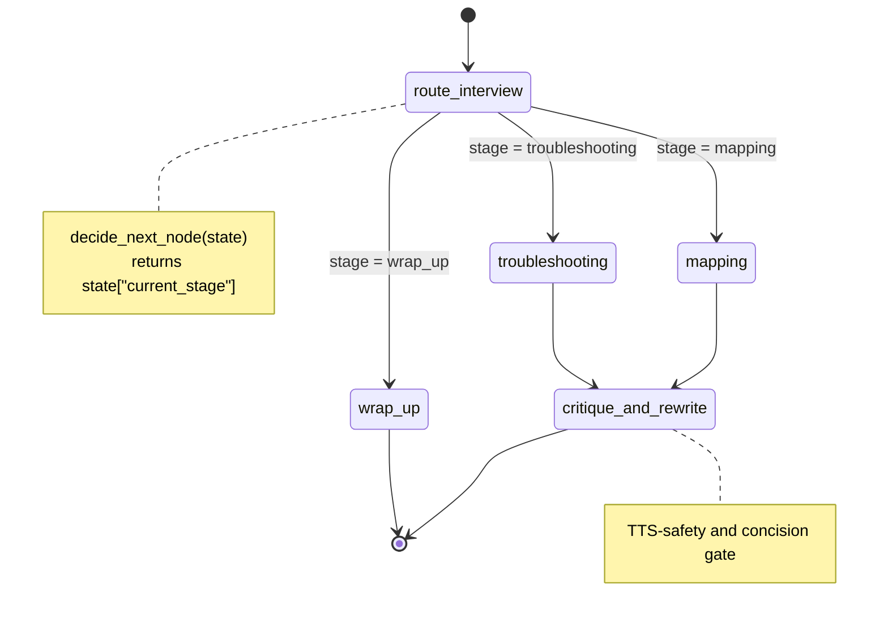

### Nodes

| Node | Model / temp | Responsibility |
| --- | --- | --- |
| `route_interview` *(entry)* | `openai/gpt-oss-120b`, 0 | Classifies the interview stage using structured output. Rules: fewer than 4 transcript lines → `mapping`; basic process mapped but no edge cases → `troubleshooting`; process and edge cases covered after 5+ deep questions → `wrap_up`. A hard keyword override sends the graph straight to `wrap_up` if the expert says "stop", "finish", or "done". |
| `mapping` | `openai/gpt-oss-120b`, 0.5 | Process-mapping questioning. If the workflow steps have not been enumerated, ask for them; once enumerated, pick exactly one step and drill into how it is executed. |
| `troubleshooting` | `openai/gpt-oss-120b`, 0.5 | Edge-case questioning. If exceptions have not been raised, ask about gotchas; once listed, pick one and ask how it is resolved. |
| `wrap_up` | none | Emits a fixed closing statement. No LLM call. |
| `critique_and_rewrite` | `openai/gpt-oss-120b`, 0 | Self-critique gate using a `CritiqueDecision` structured output. Checks the question is concise, jargon-free, and TTS-safe (no markdown, no asterisks). Rewrites it if any check fails. |

The single-step-at-a-time constraint in `mapping` and `troubleshooting` is deliberate: compound
questions produce shallow answers and are awkward to answer by voice.

---

## 11. Asset Generation and Multi-Tier Caching

`POST /api/sessions/{session_id}/generate-assets` converts a raw transcript into three structured
markdown documents.

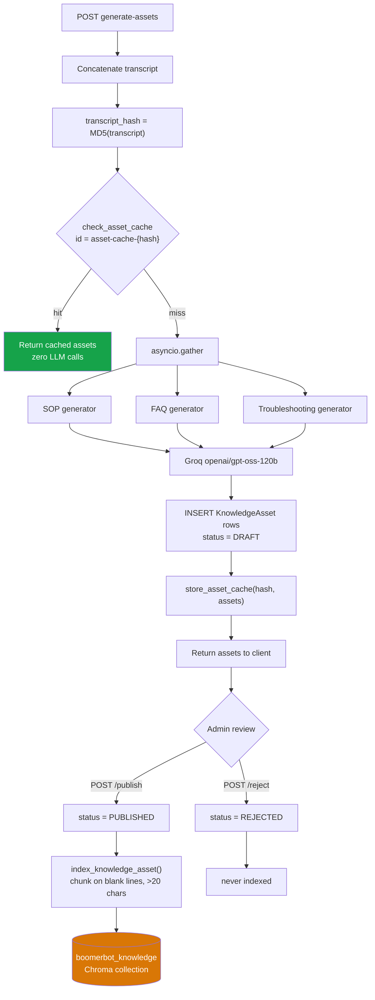

### Why parallel

The three generators are independent, so `asyncio.gather` issues them concurrently. Beyond the
obvious latency win, this spreads the work across three smaller requests instead of one large one,
which is friendlier to Groq's tokens-per-minute limits than a single monolithic generation.

### Cache tiers

BoomerBot uses ChromaDB for two distinct caching strategies, avoiding a separate Redis dependency:

| Tier | Collection | Key | Match rule | Guards against |
| --- | --- | --- | --- | --- |
| **Hash cache** | `asset_generation_cache` | `asset-cache-{md5(transcript)}` | exact | Re-generating assets when the transcript has not changed. |
| **Semantic cache** | `semantic_cache` | `cache-{md5(query)}` | vector distance `< 0.2` | Re-answering a question that is *semantically* equivalent to a previous one. |

The semantic cache is consulted by `POST /api/assistant/query` *before* the RAG graph runs; a hit
returns the stored JSON response immediately with no retrieval and no generation.

---

## 12. RAG Knowledge Assistant

### Request path

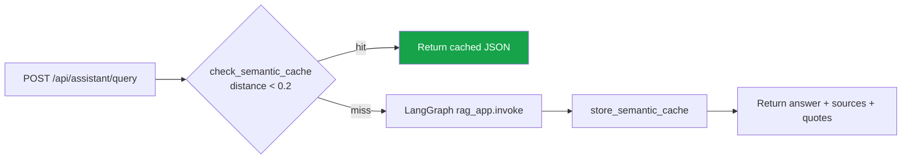

### Graph

Defined in [backend/app/rag/langgraph_agent.py](../backend/app/rag/langgraph_agent.py).

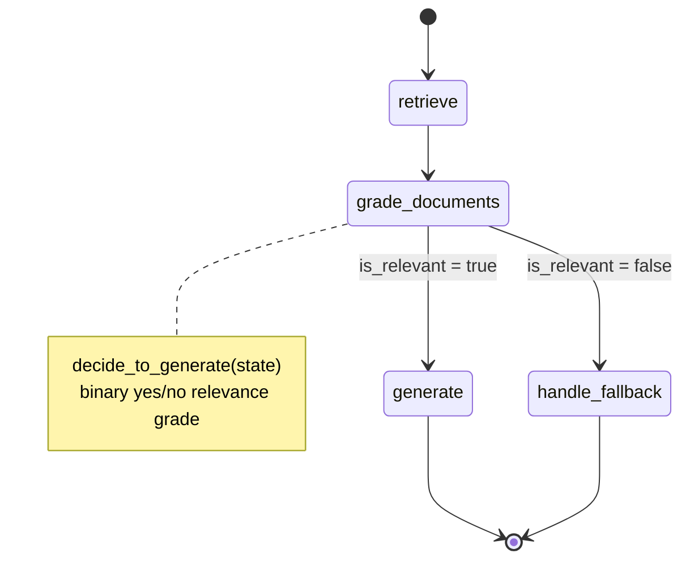

### State and nodes

```python
class GraphState(TypedDict):
    question: str
    filter_dict: dict
    documents: List[str]
    sources: List[dict]
    generation: str
    exact_quotes: List[str]
    is_relevant: bool
```

| Node | Model / temp | Responsibility |
| --- | --- | --- |
| `retrieve` *(entry)* | — | Calls `query_knowledge(question, n_results=4, filter_dict=...)`. Populates `documents` and `sources`. |
| `grade_documents` | `openai/gpt-oss-120b`, 0 | Structured `GradeDocuments` output giving a binary yes/no on whether the retrieved context actually answers the question. This is the hallucination guard. |
| `generate` | `openai/gpt-oss-120b`, 0.3 | Structured `FinalAnswer` output: an `answer` of at most three sentences plus `exact_quotes`, a list of verbatim substrings from the context. The frontend highlights those quotes to prove provenance. |
| `handle_fallback` | — | Returns an honest "I couldn't find that" response with empty quotes rather than inventing an answer. |

### Vector store

[backend/app/rag/chroma.py](../backend/app/rag/chroma.py) opens a `PersistentClient` at
`./chroma_db` and selects an embedding function at import from `EMBEDDING_PROVIDER`:
`LLMaaSEmbeddingFunction` (`text-embedding-3-large`, 3072d, batched 100 inputs per request),
`JinaEmbeddingFunction` (768d), or Chroma's bundled default (384d).

> Chroma pins the embedding function to each collection and cannot mix vector dimensions. Changing
> `EMBEDDING_PROVIDER` therefore invalidates the whole store; `reset_collections()` drops **all three**
> collections and `seed_from_excel.py` calls it. Dropping only the knowledge collection would leave
> stale-dimension cache vectors whose lookups fail silently inside the existing `try/except` blocks.

| Collection | Purpose | Metadata |
| --- | --- | --- |
| `boomerbot_knowledge` | Primary retrieval corpus of published assets | `asset_id`, `title`, `asset_type`, `domain`, `sensitivity` |
| `semantic_cache` | Cached assistant answers | `response_json` |
| `asset_generation_cache` | Cached generated asset bundles | `assets_json` |

**Chunking strategy.** `index_knowledge_asset()` splits asset content on blank lines (`\n\n`),
discards fragments shorter than 20 characters, and writes each surviving chunk under the id
`{asset_id}-chunk-{i}` with the asset's metadata attached. Because generated assets are markdown
with paragraph and section breaks, paragraph splitting keeps semantically coherent units together.

---

## 13. Data Quality Scanner

[backend/app/services/anomaly_detector.py](../backend/app/services/anomaly_detector.py) exposes
`scan_dataset(file_bytes) -> dict`, which loads an eight-sheet Excel workbook with `pandas` and
runs twelve cross-sheet integrity rules. Each result is returned as
`{title, description, count, records}`; `NaN` values are normalised to `None` so the payload is
JSON-serialisable.

| Code | Anomaly | Detection logic |
| --- | --- | --- |
| **SC-00** | Critical knowledge holder never interviewed | `knowledge_criticality = High` **and** `employment_status ∈ {Notice Period, Retiring}` **and** `employee_id ∉ Interview_Sessions` |
| **SC-01** | Orphan interview responses | `Interview_Responses.session_id ∉ Interview_Sessions.session_id` |
| **SC-02** | Post-exit authorship | `article.created_date > author.planned_exit_date` |
| **SC-03** | Unpublished content served to users | `Assistant_Interactions.matched_article_id` resolves to an article whose `status ≠ Published` |
| **SC-04** | RBAC violation | Article `sensitivity ∈ {Restricted, Confidential}` but `Access_Control.role_or_group ∈ {All-Employees, External-Contractors, New-Hires}` |
| **SC-05** | Unconverted knowledge gaps | `gap_flag = Y` **and** `converted_to_article_id` is null or empty |
| **SC-06** | Duplicate articles | Group by `(title, semantic_tags)`, flag groups with count > 1 |
| **SC-07** | False-complete sessions | `status = Completed` but `completion_pct < 80` |
| **SC-08** | Orphan domain reference | `article.domain_id ∉ Knowledge_Domains.domain_id` |
| **SC-09** | Past-exit employee still Active | `planned_exit_date < 2026-09-11` but `employment_status = Active` |
| **SC-10** | Assistant coverage gap | `answer_provided = N` **or** `satisfaction_score ≤ 2` |
| **SC-11** | Never-asked questions | `Question_Bank.question_id ∉ Interview_Responses.question_id` |

The reference date in SC-09 is hardcoded — see [§17](#17-known-limitations-and-hardening-backlog).

The scanner is surfaced through `POST /api/admin/scan-dataset` and the DataScanner page, and can be
exercised offline via [backend/test_anomaly.py](../backend/test_anomaly.py), which prints the count
for each code.

---

## 14. Frontend Architecture

### Provider and route tree

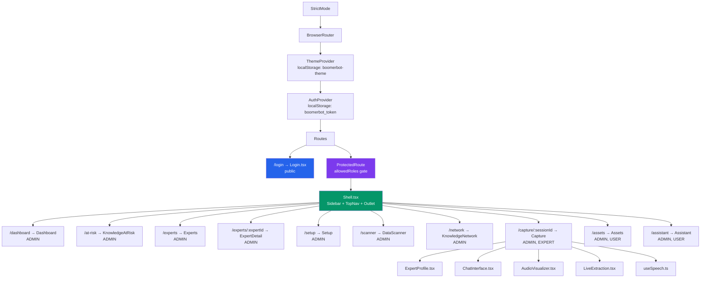

### Contexts

**`AuthContext`** — [frontend/src/contexts/AuthContext.tsx](../frontend/src/contexts/AuthContext.tsx)

```ts
interface AuthContextType {
  user: { id: string; email: string; role: 'ADMIN' | 'EXPERT' | 'USER' } | null;
  token: string | null;
  login: (token: string, user: User) => void;
  logout: () => void;
  isLoading: boolean;
}
```

The JWT is persisted in `localStorage` under `boomerbot_token` and attached manually as
`Authorization: Bearer ${token}` by each caller. `isLoading` exists so `ProtectedRoute` can render
a spinner instead of bouncing the user to `/login` during token re-validation.

**`ThemeContext`** — [frontend/src/contexts/ThemeContext.tsx](../frontend/src/contexts/ThemeContext.tsx)
persists `"dark" | "light"` under `boomerbot-theme` (default dark), toggles the class on
`document.documentElement`, and uses the View Transition API for an animated theme switch.

### Route guarding

[ProtectedRoute.tsx](../frontend/src/components/layout/ProtectedRoute.tsx) takes an optional
`allowedRoles` array. It shows a spinner while `isLoading`, redirects unauthenticated users to
`/login`, and redirects authenticated users whose role is not permitted to their role's home page
(ADMIN → `/dashboard`, USER → `/assistant`, EXPERT → active session or `/experts`).

### Page to endpoint matrix

| Page | Endpoints consumed |
| --- | --- |
| [Login.tsx](../frontend/src/pages/Login.tsx) | `POST /api/auth/token`, `GET /api/auth/me` |
| [Dashboard.tsx](../frontend/src/pages/Dashboard.tsx) | `GET /api/dashboard/stats`, `GET /api/dashboard/at-risk`, `GET /api/users/invited`, `POST /api/users/invite`, `DELETE /api/users/{id}` |
| [Setup.tsx](../frontend/src/pages/Setup.tsx) | `POST /api/sessions/upload-resume` |
| [Experts.tsx](../frontend/src/pages/Experts.tsx) | `GET /api/experts`, `DELETE /api/experts/{id}` |
| [ExpertDetail.tsx](../frontend/src/pages/ExpertDetail.tsx) | `GET /api/experts/{id}` |
| [KnowledgeAtRisk.tsx](../frontend/src/pages/KnowledgeAtRisk.tsx) | `GET /api/dashboard/at-risk` |
| [DataScanner.tsx](../frontend/src/pages/DataScanner.tsx) | `POST /api/admin/scan-dataset` |
| [KnowledgeNetwork.tsx](../frontend/src/pages/KnowledgeNetwork.tsx) | `GET /api/network-graph` |
| [Capture.tsx](../frontend/src/pages/Capture.tsx) | `GET /api/sessions/{id}`, `POST /api/sessions/{id}/complete`, `POST /api/sessions/{id}/generate-assets`, `ws://localhost:8000/ws/session/{id}` |
| [Assets.tsx](../frontend/src/pages/Assets.tsx) | `GET /api/assets`, `GET /api/assets/{id}`, `POST /api/assets/{id}/publish`, `POST /api/assets/{id}/reject` |
| [Assistant.tsx](../frontend/src/pages/Assistant.tsx) | `POST /api/assistant/query` |

### Layout components

| Component | Role |
| --- | --- |
| [Shell.tsx](../frontend/src/components/layout/Shell.tsx) | Flex container composing Sidebar, TopNav, and the routed `<Outlet />`. |
| [Sidebar.tsx](../frontend/src/components/layout/Sidebar.tsx) | Role-filtered navigation, theme toggle, current-user block, logout. |
| [TopNav.tsx](../frontend/src/components/layout/TopNav.tsx) | Page title/subtitle, global search (routes into Assistant/Assets), notifications, live status indicator. |
| [ProtectedRoute.tsx](../frontend/src/components/layout/ProtectedRoute.tsx) | RBAC gate described above. |

### Capture components

| Component | Role |
| --- | --- |
| [ExpertProfile.tsx](../frontend/src/components/capture/ExpertProfile.tsx) | Expert identity card: name, title, department, experience, expertise tags. |
| [ChatInterface.tsx](../frontend/src/components/capture/ChatInterface.tsx) | Conversation transcript; expert right-aligned, AI left-aligned, interim speech rendered in grey italic and finalised text in the primary colour. |
| [AudioVisualizer.tsx](../frontend/src/components/capture/AudioVisualizer.tsx) | Seven-bar animated microphone activity meter. |
| [LiveExtraction.tsx](../frontend/src/components/capture/LiveExtraction.tsx) | Coverage percentage plus live-updating list of `process` / `tacit` / `gap` insights. |

### Speech pipeline

[useSpeech.ts](../frontend/src/hooks/useSpeech.ts) wraps two browser APIs:

- **`SpeechRecognition`** for transcription, exposing interim results so the UI can show text as
  the expert is still speaking, and a final transcript that is sent over the WebSocket.
- **`SpeechSynthesis`** to read the agent's question aloud once `ai_stream_end` arrives. This is
  why the backend deliberately strips markdown in `critique_and_rewrite` — asterisks and hashes
  are read aloud by TTS engines.
- **Barge-in**: if the expert starts speaking while the agent is talking, synthesis is cancelled
  and recognition takes over, mirroring a natural conversation.

### Styling and API base URL

Styling is Tailwind with CSS custom properties for theming, `cva` for component variants, and a
`cn()` helper in [lib/utils.ts](../frontend/src/lib/utils.ts) combining `clsx` and `tailwind-merge`.

[vite.config.ts](../frontend/vite.config.ts) registers only the React plugin — there is **no dev
proxy**, and `http://localhost:8000` is hardcoded in each page rather than centralised in a
constant or environment variable. See [§17](#17-known-limitations-and-hardening-backlog).

---

## 15. End-to-End Knowledge Lifecycle

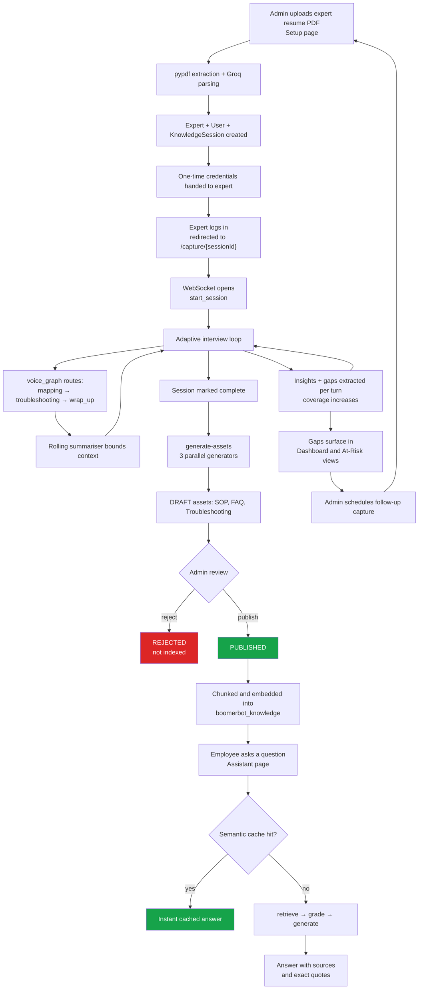

The loop closes at the bottom: unanswered gaps detected during interviews feed the At-Risk view,
which drives the next round of expert capture.

---

## 16. Local Development Setup

### Prerequisites

- Python 3.11+ (the checked-in virtualenv uses 3.14)
- Node.js 20+
- A Groq API key; optionally a Jina API key

### Backend

```powershell
cd backend
.\myvenv\Scripts\Activate.ps1          # or: python -m venv myvenv
pip install -r requirements.txt
python -m uvicorn app.main:app --host 0.0.0.0 --port 8000 --reload
```

API docs are then available at `http://localhost:8000/docs`.

### Frontend

```powershell
cd frontend
npm install
npm run dev                             # http://localhost:5173
```

### Environment variables

Create `backend/.env` (never commit it):

```ini
GROQ_API_KEY=...
JINA_API_KEY=...
CLOUDINARY_URL=...
SECRET_KEY=...                          # override the insecure default
DATABASE_URL=sqlite:///./boomerbot.db
```

### Default credentials

The admin account `admin@boomerbot.com` / `password123` is seeded automatically on first startup.
Change or remove this before any non-demo deployment.

### Utility scripts

| Script | Purpose |
| --- | --- |
| `python migrate_db.py` | Adds `department`, `role`, `experience`, `expertise` columns to `knowledge_sessions`. Idempotent. |
| `python seed_from_excel.py` | **Destructive.** Drops and recreates all tables, wipes the Chroma collection, then loads eight sheets from `BoomerBot_Synthetic_Dataset.xlsx` — domains, employees, question bank, sessions, responses, articles, access control, assistant interactions — creating experts, expert users, sessions, transcript messages, gap insights, and indexing published articles into the vector store. |
| `python test_anomaly.py` | Prints SC-00..SC-11 counts for the synthetic dataset. |

### Platform notes

**Windows.** `uvloop` is Linux/macOS-only and its build script raises an error on Windows, so
[requirements.txt](../backend/requirements.txt) pins it with an environment marker:

```text
uvloop==0.22.1; sys_platform != "win32"
```

pip skips it on Windows and installs it normally elsewhere.

**Corporate networks with TLS inspection.** On networks running a TLS-inspecting proxy such as
Zscaler, outbound HTTPS from Python fails with
`CERTIFICATE_VERIFY_FAILED: unable to get local issuer certificate`, because `httpx` trusts
`certifi`'s CA bundle rather than the OS trust store that already contains the proxy's root CA.
The application handles this by calling `truststore.inject_into_ssl()` at the very top of
[main.py](../backend/app/main.py), which keeps certificate verification fully enabled while
sourcing trust anchors from the OS. It is a no-op on unfiltered networks.

> **Note:** `seed_from_excel.py` and `test_anomaly.py` do not go through `app.main`, so they do not
> get this injection. `seed_from_excel.py` makes outbound calls when indexing into Chroma with Jina
> embeddings and will therefore still fail on a TLS-inspecting network. Run it off the corporate
> network, or add the same two lines to the top of the script.

---

## 17. Known Limitations and Hardening Backlog

The system was built for a hackathon. The following are known, deliberate trade-offs that must be
addressed before any production or internet-facing deployment.

### Security

| # | Issue | Location | Impact | Remediation |
| --- | --- | --- | --- | --- |
| 1 | **Unauthenticated WebSocket.** `/ws/session/{session_id}` performs no JWT validation, so anyone who can guess or obtain a session id can join an interview, inject expert turns, and read the stream. | [ws.py](../backend/app/api/ws.py) | Broken access control (OWASP A01) | Validate a token passed via subprotocol or query parameter on `accept`, and verify the caller owns the session. |
| 2 | **Unauthenticated network graph.** `GET /api/network-graph` has no auth dependency and returns expert names, departments, domains, and insight topics. | [rest.py](../backend/app/api/rest.py) line 201 | Information disclosure | Add `Depends(require_role([...]))` consistent with the other routes. |
| 3 | **Hardcoded default `SECRET_KEY`.** If `.env` omits it, JWTs are signed with a value committed to the repository, allowing anyone to forge an ADMIN token. | [config.py](../backend/app/core/config.py) | Authentication bypass (OWASP A02/A07) | Remove the default and fail fast at startup if unset. |
| 4 | **Wide-open CORS.** `allow_origins=["*"]` combined with `allow_credentials=True`. | [main.py](../backend/app/main.py) | CSRF / cross-origin abuse | Pin to the known frontend origin per environment. |
| 5 | **Seeded admin with a known password.** `admin@boomerbot.com` / `password123` is created automatically. | [main.py](../backend/app/main.py) | Trivial account takeover | Gate behind a `SEED_DEMO_DATA` flag; force a password change on first login. |
| 6 | **JWT lifetime of 7 days with no refresh or revocation.** A leaked token stays valid for a week. | [config.py](../backend/app/core/config.py) | Extended compromise window | Short-lived access tokens plus refresh tokens and a revocation list. |
| 7 | **No rate limiting.** LLM-backed endpoints are unthrottled. | all routers | Cost abuse / DoS | Per-user throttling on `/api/assistant/query` and `generate-assets`. |
| 8 | **No file-upload validation beyond extension.** PDF and XLSX uploads are parsed directly. | `upload-resume`, `scan-dataset` | Malicious file parsing | Enforce size caps, verify magic bytes, parse in a sandbox. |
| 9 | **Document `sensitivity` is stored but not enforced at query time.** Chroma metadata carries a sensitivity field, yet the assistant does not filter on the caller's clearance — even though SC-04 exists to detect precisely this class of problem in the source dataset. | [chroma.py](../backend/app/rag/chroma.py) | Data exposure | Pass a `filter_dict` derived from the caller's role into `query_knowledge`. |

### Reliability and scale

| # | Issue | Impact | Remediation |
| --- | --- | --- | --- |
| 10 | **SQLite single-writer.** Concurrent interviews plus dashboard traffic will hit `database is locked`. | Contention under load | Move to PostgreSQL; `psycopg2-binary` is already a dependency. |
| 11 | **In-process `asyncio` tasks.** Summarisation and insight extraction are fire-and-forget tasks; a worker restart loses them silently. | Data loss | Move to a durable queue such as Celery, RQ, or ARQ. |
| 12 | **In-memory WebSocket state.** A single-process assumption prevents horizontal scaling. | Cannot scale out | Externalise session state; use a pub/sub broker for fan-out. |
| 13 | **No schema migration tooling.** `create_all` plus a hand-rolled `migrate_db.py` cannot handle type changes, drops, or rollbacks. | Migration risk | Adopt Alembic. |
| 14 | **Unbounded Chroma cache growth.** Neither cache collection has eviction or TTL. | Disk growth, stale answers | Add TTL metadata and a periodic compaction job. |
| 15 | **No retry or circuit breaker on Groq calls.** A transient upstream failure surfaces directly to the user. | Brittleness | Wrap calls with exponential backoff; `tenacity` is already available. |

### Maintainability

| # | Issue | Remediation |
| --- | --- | --- |
| 16 | `http://localhost:8000` is hardcoded in every page, and the WebSocket URL uses `ws://` unconditionally. | Introduce a single `API_BASE_URL` from `import.meta.env`, and derive `ws`/`wss` from the page protocol. |
| 17 | Each page hand-rolls `fetch` with manual `Authorization` headers. | Extract a shared API client that injects the token and handles 401 by logging out. |
| 18 | Hardcoded reference date `2026-09-11` in SC-09. | Use the current date or an explicit parameter. |
| 19 | Demo expert auto-provisioning inside the WebSocket handler. | Remove, or gate behind a demo-mode flag. |
| 20 | JSON payloads stored as `Text` columns (`projects`, `experience_details`). | Use a native JSON column type, or normalise into proper tables. |
| 21 | No automated test suite; `test_anomaly.py` is a print-based smoke script. | Add pytest coverage for auth, RBAC, the anomaly rules, and both graphs. |
| 22 | No structured logging, metrics, or tracing. LangSmith is a dependency but unconfigured. | Enable LangSmith tracing for the graphs; add structured request logging. |
